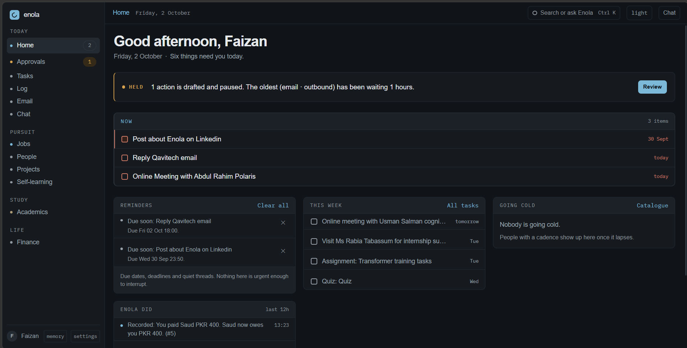
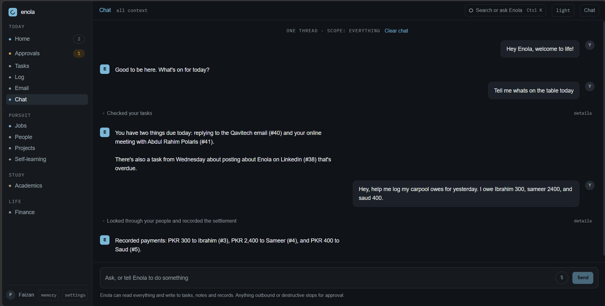
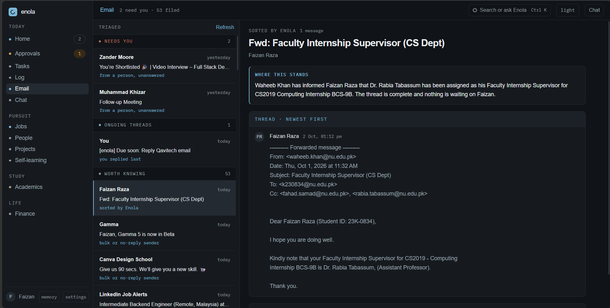
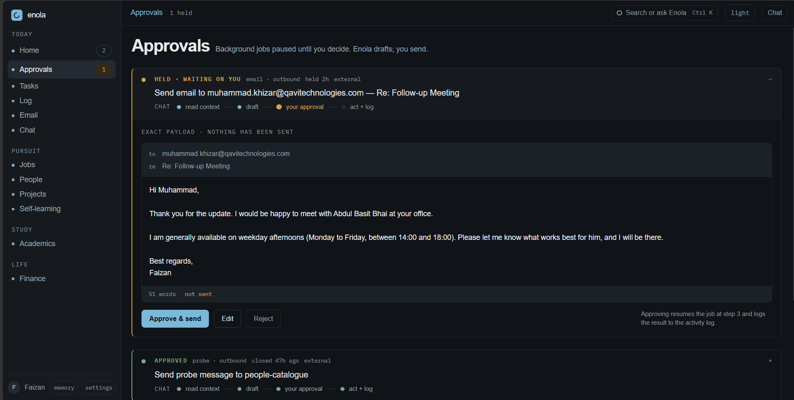

# Enola

A personal AI agent that holds one person's context — tasks, coursework, finances, people, email — and acts on it.

It proposes; it never acts unattended. Anything that leaves the system or destroys a record stops and waits to be approved.



---

## Why it exists

My coursework, job hunt, finances and inbox lived in five different places, and nothing connected them. A chatbot can answer questions about any one of them if I paste the context in first. What I wanted was something that already *has* the context and can act on it — file the deadline, draft the follow-up, notice the recruiter who went quiet eleven days ago.

## What it does

- **Dashboard** — what needs you today: Held approvals, overdue work, a daily brief, contacts going cold
- **Tasks** — due dates, priorities, links to projects, courses and applications
- **Academics** — courses, deadlines, uploaded materials, FYP milestones, and a chat scoped to a single course's documents
- **Email** — IMAP triage into needs-reply / ongoing / noise, thread summaries, and drafted replies that go to Held before sending
- **Finance** — expenses, income, transfers, splits and partial settlements, with balances always derived
- **People** — who you know, when you last spoke, a nudge when someone valuable goes quiet
- **Memory** — what Enola believes about you, editable when it is wrong
- **Chat** — text or push-to-talk voice, with a ⌘K/Ctrl+K palette over everything



*One sentence in; two tool calls and three records out. Each grey line is what it actually did, expandable to the call itself.*



*Triage runs on headers first and only spends the model on what survives — 2 needing a reply out of 55.*

## The idea that shapes everything else

The screen list is not the interesting part. Enola doesn't just answer — it sends, writes and deletes, and anything that acts on your real life needs the one thing a chat app never needs: a way to stop it.

**Every tool declares a risk level, and the registry — not the tool — decides whether it runs.**

| Level | Behaviour |
|---|---|
| `SAFE` | reads; runs freely |
| `WRITE_LOCAL` | writes Enola's own database; runs freely, logged |
| `EXTERNAL` | sends, posts → **Held** |
| `DESTRUCTIVE` | deletes, bulk edits → **Held** |
| `UNCLASSIFIED` | **Held** — the default when no level is given |

When the agent reaches for a gated tool, the graph calls LangGraph's `interrupt()`. The run **pauses**, an `approval_request` row is written, and the graph state is checkpointed to Postgres. You see the exact payload — recipient, subject, body — and approve, edit or reject it. On approval the run **resumes from that checkpoint** and the tool finally executes.

Three properties fall out of putting the classification in the registry rather than in tool code:

- A tool added later **cannot opt out** of the gate.
- An unregistered or unclassified tool name is gated, so nothing runs on the strength of a name alone.
- Because the checkpoint is in Postgres, a Held action **survives a restart** — which is why an in-memory checkpointer was never an option.

The paused state is called **Held** everywhere: in the database, the API, the UI, and in conversation about it.



*Nothing has been sent. The run is parked on a Postgres checkpoint until one of those three buttons is pressed — and it is still parked there after a restart.*

## How it is built

```
React + TypeScript (Vite, CSS Modules)
        │  same-origin; Vite proxies /api in dev
        ▼
FastAPI  ──  LangGraph agent core  ──  Gemini
        │
        ▼
Postgres + pgvector  ◄── APScheduler worker (separate process)
        │
        └─ Gmail IMAP (read-only) / SMTP (send, after approval)
```

The worker never shares in-process state with the API — they communicate only through Postgres, so they could run on different machines. Scheduled jobs don't deliver anything themselves; they queue rows into a notification outbox, and delivery channels drain it. Adding web push later is one new class.

TypeScript types and enums are **generated** from the OpenAPI schema, so a Pydantic change surfaces as a compile error rather than a runtime surprise.

### Where things live

```
enola/
  api/       FastAPI: main.py, routers/, crud.py (one generic CRUD router)
  core/      config, db, enums (shared with web), models/, schemas/, services/,
             repository.py, storage.py, mailer.py, auth.py
  agent/     registry.py (the gate), graph.py (LangGraph + interrupt),
             checkpoint.py, service.py, models.py (provider + roles),
             speech.py, tools/, memory/, prompts/
  workers/   scheduler.py, jobs/ (reminders, nudges, brief), outbox.py
  ingest/    documents.py, embeddings.py, mail.py
  scripts/   dev, seed, demo_held, export_openapi, export_enums
web/src/
  theme/     tokens.css — every colour, space and radius
  ui/        primitives: Button, Card, Field, Table, Sheet, Badge, EmptyState…
  shell/     nav, header, chat rail, ⌘K palette, splash, phone tabs
  data/      one server-state layer (TanStack Query over the generated client)
  screens/   one screen per file
  lib/       formatting, platform detection, small shared helpers
tests/       the four mandatory gate tests, plus scoring, dedupe and scheduling
alembic/     migrations; never edited after being applied
docker/      Postgres init scripts (compose file is at the root)
```

## Worth reading, if you only read two files

- **[`enola/agent/registry.py`](enola/agent/registry.py)** — the gate. Short, and the design intent is on the surface.
- **[`tests/test_approval_gate.py`](tests/test_approval_gate.py)** — four mandatory tests asserting real properties: the side effect does not fire before approval, resume preserves the original arguments and fires exactly once, rejection leaves no partial writes, and an unclassified tool defaults to gated.

## Decisions I would defend

- **Email triage is two passes, cheap first.** Headers (`List-Unsubscribe`, `Precedence`, no-reply senders) remove about 90% of an inbox for free, so the model only classifies the handful that survive. With no model available the heuristic answer stands and the screen still works.
- **IMAP is read-only by construction** — every mailbox opens `readonly=True` and the module contains no append, flag, move or delete path. Not a convention; there is no code to misuse.
- **Balances are derived, never stored.** Settlements are their own rows with allocations against split shares, so a repayment can be partial and can exist without being tied to one expense — which is how paying someone back actually works.
- **Assessments write into `task`.** A quiz deadline *is* a task underneath, so one reminder pipeline covers coursework and everything else, and a deadline shows up in the morning brief rather than hiding in its own tab.
- **Model choice came from measurement, not documentation.** Google no longer publishes free-tier rate limits — they are per-project. Measured against this key, the obvious model allowed 5 requests a minute; one chat turn spends two to four on tool calls, so the agent loop was unusable. Its lighter sibling ran 14 in 11 seconds and binds all 22 tools without a schema error.

## Not built

- **Job tracking and discovery** — the pipeline and the daily board scraping exist in the codebase but are not working well enough to rely on. Treat them as in progress.
- **No hosting** — it runs locally.
- **No login rate limiting**, which blocks any public deployment.
- **No CI**, no metrics, no error tracking.
- **No test-prep question generation** — the Academics tab says so rather than faking it.
- **`completed_at` is not settable through the API**, so "I finished this on Monday" cannot yet be recorded.

## Running it

Single user, single machine, by design. Prerequisites: Docker Desktop, Python 3.12+, Node 20+.

```bash
cp .env.example .env
python -m venv .venv && .venv/Scripts/pip install -e ".[dev]"
python -m enola.core.auth hash "your password"      # paste the hash into .env
python -m enola.scripts.seed --reset                # sample data; --wipe for an empty start
```

Then one command, every time:

```bash
./enola.sh      # Git Bash / WSL     ·     enola.cmd on PowerShell or Explorer
```

That starts Postgres, waits for it, applies migrations, then runs the API, the worker and the web dev server in one terminal with prefixed output. Ctrl+C stops all three and sweeps their process trees.

`GOOGLE_API_KEY` makes the agent think. Without it every screen still works, the worker still runs, and Held items can still be approved — only new chat turns are refused. To see the approval flow with no key at all:

```bash
python -m enola.scripts.demo_held     # drafts a recruiter follow-up and Holds it
```

<details><summary>Checks</summary>

```bash
.venv/Scripts/mypy enola                           # strict, must be clean
.venv/Scripts/pytest tests                         # needs the compose test database
cd web && npm run typecheck && npm run lint && npm run build
```

After changing any Pydantic schema, regenerate the web types:

```bash
python -m enola.scripts.export_openapi && (cd web && npm run gen:api)
python -m enola.scripts.export_enums
```

</details>
